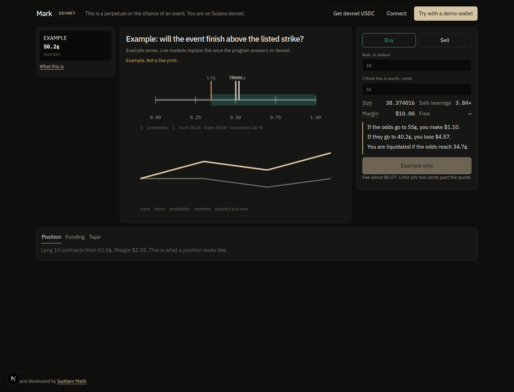
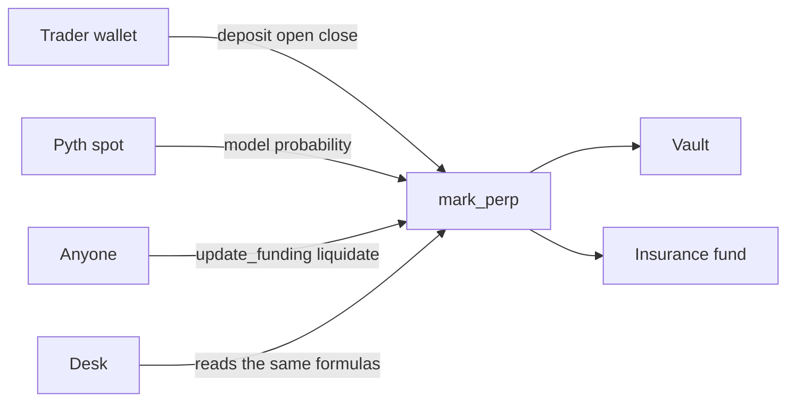
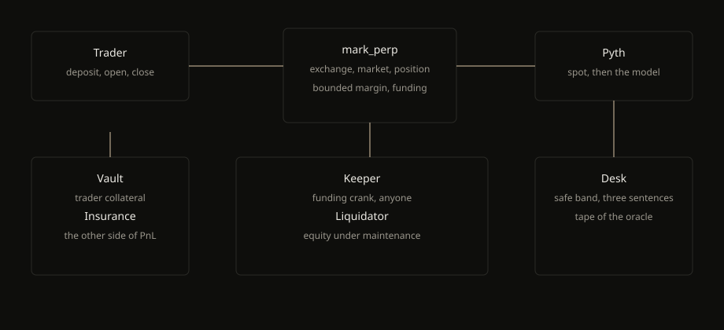

# Mark

Perpetual markets on event odds. Trade the probability, not the asset.

A prediction market today sells a prepaid share. A perpetual venue will leverage the asset underneath the event, and will not leverage the event. Mark is the contract in the middle: an isolated-margin perpetual whose price lives between 0 and 1, whose margin shrinks the room to a total loss, and whose funding pulls the traded price back to a published index.

Built and developed by Saddam Malik — [saddammalik.com](https://saddammalik.com)



## The desk

The trading screen is one page. The rail is the position. The ticket is three sentences: what you make if you are right, what you lose if you are wrong, and the price that liquidates you.

Until the app is deployed, run it locally against devnet:

```bash
cd app
npm install
npm run dev
```

The badge in the header says **Devnet**. Connect Phantom, Solflare, Backpack, or MetaMask's Solana account, or press **Try with a demo wallet**. Then **Get devnet USDC**. The suggested risk is $10. Read the sentences and sign.

## How a position works

One contract pays $1.00 if the probability moves by 1.00, so a one-cent move is $0.01 per contract.

Prices inside the program are micro-units: `1_000_000` is certainty, and the book never writes 0 or 1. It clamps to `0.001`–`0.999`.

Open a long of two contracts when the index is 50¢ and nobody else is in the market.

- The mark starts at 50¢.
- Ten contracts of imbalance move the mark by one cent. Impact is half that slope, so two contracts fill at 50.1¢.
- After the trade the mark sits at 50.2¢.
- Worst-case loss on the long is $1.002. Half of that is $0.501, which is the margin the program locks.
- The taker fee is 0.20% of the one-dollar notional: $0.004.
- Close immediately, with no funding and no index move, and the fill is 50.1¢ again. The round trip costs the two fees, $0.008.

That round trip is a LiteSVM test, not a story.

## Margin and the safe band

Initial margin is the greater of three floors:

- 5% of the one-dollar contract notional
- 50% of the worst loss, to 0 for a long and to 1 for a short
- the one-dollar notional divided by the max leverage (20)

| One contract | Worst loss | Initial margin | Safe leverage |
|---|---|---|---|
| Long at 50¢ | $0.50 | $0.25 | 4.0× |
| Long at 90¢ | $0.90 | $0.45 | 2.2× |
| Short at 90¢ | $0.10 | $0.05 | 20× |
| Short at 10¢ | $0.90 | $0.45 | 2.2× |

A 90¢ long posts more than a 50¢ long. The event got obvious, so the margin grew. A short of a long-shot posts a lot, because the odds can still run to one.

Maintenance is the same shape at half the rates (2.5% floor, 25% of the remaining worst loss). A position is liquidated when equity is strictly below maintenance. For the one-contract long above, entered at 50¢ with $0.25 of margin and no funding owed, that price is **33.3332¢**. The rail draws it. The ticket says it. The program uses it.

## Funding

Once an hour, the premium per contract is `(mark − index) / 10`, capped at $0.05.

Mark at 52¢ and index at 50¢ is a two-cent basis. The premium is $0.002 per contract. Sixty contracts pay **$0.12** this hour. Longs pay when the mark is rich. Shorts pay when it is cheap.

The insurance fund is the other side of the payment. If the open interest is balanced, the fund is flat and the longs have paid the shorts. If the book is one-sided, the fund keeps or pays the imbalance — the same imbalance that pushed the mark. The desk says which of those is true.

## Oracles and settlement

| Market | Question | Index | Max age |
|---|---|---|---|
| `SOL-ABOVE-WEEK` | SOL/USD above a listed strike at Friday 21:00 UTC | Pyth SOL/USD, then the model below | 6 hours |
| `BTC-ABOVE-WEEK` | BTC/USD above a listed strike at Friday 21:00 UTC | Pyth BTC/USD, then the model below | 6 hours |
| `EVENT-ODDS` | Is mainnet-beta listed operational at Friday 21:00 UTC? | A published reference, posted by the admin | 7 days |

The model, which the desk labels as a model:

```
p = 0.50 + (spot − strike) / (2 × strike)
```

clamped to 0.001–0.999. It is 0.50 when spot equals the strike. A confidence wider than 2.5% of the price is rejected. A print older than the market's max age blocks opens, closes, liquidations, and funding. After `settle_expired`, closes use the frozen settlement price only.

Pyth feed ids pinned in the init script:

- SOL/USD `ef0d8b6fda2ceba41da15d4095d1da392a0d2f8ed0c6c7bc0f4cfac8c280b56d`
- BTC/USD `e62df6c8b4a85fe1a67db44dc12de5db330f7ac66b72dc658afedf0f4a415b43`

## Architecture





Collateral is a six-decimal mint controlled by the exchange. Traders' balances live in the vault. The insurance vault pays winners and receives losers. The fee vault takes the 0.20% taker fee. A shortfall the fund cannot cover pauses that market. The admin can pause and can retune risk parameters. The admin cannot withdraw a trader's collateral.

## Addresses

| | |
|---|---|
| Program | `EwCuCZyudnEjbHZ6wFYZtZBnpJaGEYsX2X8VJiMh5MrG` |
| Cluster | Devnet |
| Source | this repository |

The exchange, mint, and three markets are created by `scripts/init_markets.ts` and printed when it finishes. This environment did not receive a devnet SOL airdrop, so the program is built and tested here and not yet deployed. The deploy is one command, below.

## Run it

```bash
# programs
sh scripts/deploy.sh
cd app && npx tsx scripts/init_markets.ts

# desk
cd app
npm install
npm run dev
```

`scripts/deploy.sh` expects the Solana CLI and `anchor` 1.2.2. It reads the admin key from `keys/admin.json` (or `ADMIN_KEYPAIR`) and the program key from `keys/mark_perp-keypair.json` (or `PROGRAM_KEYPAIR`). Neither key is in the repository; `keys/` is ignored. Deploying to the id above needs the program key whose address matches it.

```bash
cd app && npx tsx scripts/keeper.ts       # one funding crank
cd app && npx tsx scripts/demo_flow.ts     # faucet, open, close, Solscan links
node scripts/verify_tx.mjs <signature>      # logs for a devnet transaction
```

The app is a normal Next.js build. On Vercel, set the root to `app` and point `NEXT_PUBLIC_RPC_URL` at devnet.

## Verify it yourself

```bash
anchor build
cargo test -p mark_perp --lib
cargo test --manifest-path sim/Cargo.toml
cd app && npm run build
```

The library tests cover the formulas: the 90¢ margin, the funding sign, the flat round trip, and the 33.3332¢ liquidation. The LiteSVM tests run the program. They deposit, open, crank funding, close, reject a stale oracle, pause, liquidate, drain the insurance fund, and settle an expired market.

## Repo

| Path | What it is |
|---|---|
| `programs/mark_perp` | The Anchor program |
| `sim` | LiteSVM tests against the compiled program |
| `app` | The desk and `/docs` |
| `scripts` | Deploy, init, keeper, demo, verify |
| `docs/images` | The architecture drawing |

## Licence

MIT. Copyright © 2026 Saddam Malik. Third-party libraries are listed in [NOTICE](NOTICE). They are dependencies, not authors.

## Disclaimer

This is unaudited software on Solana devnet. It is a hackathon demo. It is not an offer to operate an exchange, and it is not a place to deposit money you cannot afford to lose. Mainnet is not deployed.
